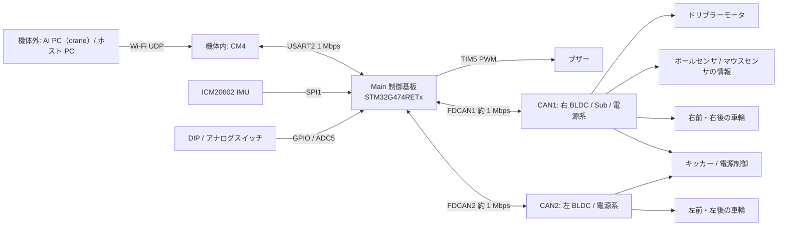

# システム構成

Orion ロボットを構成する制御機の役割と通信経路をまとめる。基板間の物理配線、電源系統、各基板の回路は回路図で確認していない。CAN の接続先は、Main ファームウェアの送信先 ID と受信内容から読み取った論理構成である。

## 全体像

図では Sub、ボールセンサ、マウスセンサを CAN1 側に置いたが、物理的にどちらのバスにつながっているかは確認していない。Sub へのファームウェア照会は CAN1 に送るが、センサの受信処理は CAN1 と CAN2 で共通である。

## 制御機と役割

| 機器 | 役割 | 主な接続 |
|---|---|---|
| AI PC（crane） | 機体ごとの指令（位置指令 mode 4、または速度指令 mode 3）を送る。CM4 経由で届くテレメトリを受ける。 | Wi-Fi、UDP |
| CM4（Raspberry Pi CM4） | 指令を受け、mode 4 なら位置制御ループを閉じて mode 3 の速度指令にして Main へ送る。Main のテレメトリを UDP で配る。ローカルカメラでボールを検出する。MCU のファームウェア更新を指示する。詳細は [cm4/](../cm4/overview.md)。 | Wi-Fi、Main と USART2 |
| Main 制御基板（STM32G474RETx、Cortex-M4F） | 500 Hz で姿勢とオドメトリの更新、速度と車輪角度の制御、停止判定、CAN 指令の生成を行う。IMU と操作スイッチを直接読む。詳細は [stm/](../stm/overview.md)。 | SPI1、ADC/GPIO、USART2、FDCAN1/2 |
| 右 BLDC 基板（STM32F303） | 右前・右後の車輪モータを駆動し、回転速度、エンコーダ角度、電流、温度などを返す。 | FDCAN1、走行指令 ID `0x100`/`0x101` |
| 左 BLDC 基板（STM32F303） | 左後・左前の車輪モータを駆動し、同様のフィードバックを返す。 | FDCAN2、走行指令 ID `0x102`/`0x103` |
| Sub 基板（STM32F303） | ファームウェア上は独立した CAN ノード。Main はボール検出とマウスセンサのデータを CAN で受ける。ドリブラー指令は CAN1 の ID `0x104`。センサとドリブラーが基板上のどこに実装されているかは確認していない。 | FDCAN1 |
| 電源基板（STM32F303） | 電源の ON/OFF、保護パラメータ、キッカーの充電・電圧・種類・発射の指令を受け、バッテリ電圧、キャパシタ電圧、温度などを返す。 | 指令は FDCAN1/2 の両方へ送る |

CAN の ID 一覧は [ハードウェア仕様](../stm/board_spec.md#fdcan)、ファームウェア更新時のノード番号は [MCU ファームウェア更新](firmware_update.md#対象とノード) を参照。

## 制御と情報の流れ

1. crane は機体ごとの指令を Wi-Fi で CM4 へ送る（[制御パケット](control_packet.md)）。
2. CM4 は mode 4 の位置指令なら位置制御ループを閉じ（[位置制御](../cm4/position_control.md)）、72 B の UART フレームで Main へ送る。
3. Main は TIM7 の 2 ms 周期で指令、モードスイッチ、通信状態を確認する。IMU の yaw、車輪エンコーダ、マウスセンサ、外部ビジョンを姿勢と位置の推定に使う。
4. Main は目標並進速度に加速度制限をかけ、旋回指令と合わせて 4 輪の目標回転に変換する。各輪の角度と回転速度のフィードバックから出力を計算し、CAN で左右の BLDC 基板へ送る（[速度制御](../stm/speed_control.md)）。
5. キッカーとドリブラーは、指令とボール検出をもとに制御する。Main は電源系、モータ、エラーの状態を CAN で受け、128 B のテレメトリにして CM4 へ返す（[フィードバックパケット](feedback_packet.md)）。
6. 通信途絶やビジョン喪失のときは、走行出力を止める（[停止判定](safety_stop.md)）。

## 機体番号とネットワーク

この文書群では、**機体番号 `N`** をロボット ID（0〜10）の意味で使う。CM4 の IP は `192.168.20.(100 + N)` である。CM4 上の各プロセスは `wlan0` の IP の末尾オクテット（`100 + N`）から `N` を求める。`ai_cmd_v2.out` は、求めた `N` が 0〜10 の範囲外なら起動を中止する。ホストツールの走査範囲はこれより広い（`host-launcher` は `.100`〜`.112`、`cm4-fleet` は既定で `N` = 0〜12）。

| 用途 | 宛先 | 方向・形式 |
|---|---|---|
| 制御指令 | `192.168.20.(100 + N):12345` | crane → CM4、UDP ユニキャスト 65 B（[制御パケット](control_packet.md#機体別の制御パケット65-バイト)） |
| 位置制御設定 | `192.168.20.(100 + N):12350` | crane → CM4、UDP ユニキャスト 28 B（[位置制御設定パケット](config_packet.md)） |
| CM4 制御 API | `http://192.168.20.(100 + N):8000` | ホスト → CM4、HTTP（[CM4 概要](../cm4/overview.md#制御-api)） |
| カメラ API | `http://192.168.20.(100 + N):8001` | ホスト → CM4、HTTP（[カメラ](../cm4/camera.md)） |
| カメラ座標 | `224.5.10.(100 + N):(5100 + N)` | CM4 → ホスト、UDP multicast、文字列 |
| robot feedback | `224.5.20.(100 + N):(50100 + N)` | CM4 → crane・ホスト、UDP multicast 128 B（[フィードバックパケット](feedback_packet.md)） |
| robot feedback（CM4 内） | `127.0.0.1:(50100 + N)` | `robot_feedback.out` → `ai_cmd_v2.out`、UDP ユニキャスト 128 B |
| ローカルカメラ（CM4 内） | `127.0.0.1:8890` | `cam_server_v3` → `ai_cmd_v2.out`、UDP 7 B |
| CM4 ↔ Main | `/dev/serial0`、1 Mbps 8N1 | 指令 72 B / テレメトリ 128 B |

例：機体番号 10 の CM4 は `192.168.20.110`。feedback は `224.5.20.110:50110`、カメラ座標は `224.5.10.110:5110` に出る。

シミュレーション時のポートは [シミュレーション](../pc/simulation.md#ポート) を参照。
