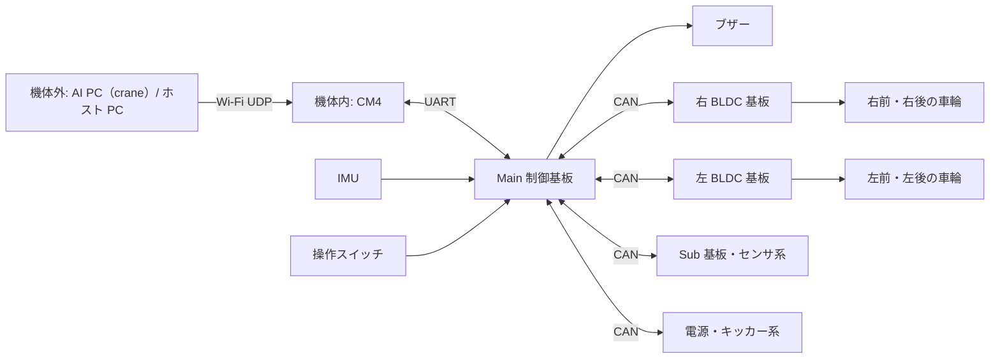

# システム構成

Orion（4 輪オムニホイール）と Atlas（4 輪ステアリング）の共通の制御経路と、Orion で確認した機能構成をまとめる。CM4 から送るパケット定義は共通で、物理通信、Main のハードウェア、車輪への指令変換、フィードバック、停止動作、MCU 更新は機種ごとに扱う（[STM 概要](../stm/overview.md)）。

## 共通の制御経路

```text
AI PC（crane） → CM4 → 機種別 Main → 車輪・周辺機器
              位置指令を速度指令へ変換
```

CM4 は mode 4 の位置指令を受けると位置制御ループを閉じ、mode 3 の速度指令を Main へ送る。コマンドのレイアウトとフィールドの意味は [制御パケット](control_packet.md)、Orion と Atlas の STM 側の入口はそれぞれ [Orion 概要](../stm/orion_overview.md) と [Atlas の記載状況](../stm/overview.md#atlas) を参照。

## CM4 と Main の通信

| 機種 | 物理通信 | 状況・参照先 |
|---|---|---|
| Orion | UART | 現行実装。[CM4 通信の設定と受信・送信処理](../stm/orion_board_spec.md#cm4-との通信) |
| Atlas | SPI | 採用予定。[記載状況](../stm/overview.md#atlas) |

送信内容は共通の [CM4→Main パケット](control_packet.md#cm4main-パケット72-バイト) に従う。Atlas の SPI の転送手順はこの文書群には未記載であり、現行の Orion 用 UART ブリッジの対応範囲とは区別する。

## Orion の機能構成

以下の図と構成表は Orion の記録である。Main と各機能基板の役割と通信経路を示す。



## Orion の制御機と役割

| 機器 | 役割 | 主な接続 |
|---|---|---|
| AI PC（crane） | 機体ごとの指令（位置指令 mode 4、または速度指令 mode 3）を送る。CM4 経由で届くテレメトリを受ける。 | Wi-Fi、UDP |
| CM4（Raspberry Pi CM4） | 指令を受け、位置制御と Main への転送を行う。Main のテレメトリを UDP で配る。ローカルカメラでボールを検出する。MCU のファームウェア更新を指示する。詳細は [cm4/](../cm4/overview.md)。 | Wi-Fi、UART |
| Main 制御基板（STM32G474） | 姿勢とオドメトリの更新、速度と車輪角度の制御、停止判定、各機能基板への指令生成を行う。IMU と操作スイッチを読む。周期と通信設定は [基板仕様](../stm/orion_board_spec.md)、操作は [Orion 概要](../stm/orion_overview.md)。 | CM4、IMU、操作スイッチ、CAN |
| 右 BLDC 基板 | 右前・右後の車輪モータを駆動し、回転速度、エンコーダ角度、電流、温度などを返す。 | CAN |
| 左 BLDC 基板 | 左後・左前の車輪モータを駆動し、同様のフィードバックを返す。 | CAN |
| Sub 基板・センサ系 | Main にボール検出とマウスセンサの情報を返す。Main はドリブラーへの指令も送る。センサとドリブラーの基板上の実装位置は確認していない。 | CAN |
| 電源・キッカー系 | 電源の ON/OFF、保護パラメータ、キッカーの充電・電圧・種類・発射の指令を受け、バッテリ電圧、キャパシタ電圧、温度などを返す。 | CAN |

ファームウェア更新で指定するバスとノード番号は [MCU ファームウェア更新](firmware_update.md#対象とノード) を参照。

## Orion の制御と情報の流れ

1. crane は機体ごとの指令を Wi-Fi で CM4 へ送る（[制御パケット](control_packet.md)）。
2. CM4 は位置指令なら位置制御ループを閉じ（[位置制御](../cm4/position_control.md)）、共通パケットを Orion の UART で Main へ送る。
3. Main は [制御周期](../stm/orion_board_spec.md#制御周期) ごとに指令、モードスイッチ、通信状態を確認する。IMU の yaw、車輪エンコーダ、マウスセンサ、外部ビジョンを姿勢と位置の推定に使う。
4. Main は目標並進速度に加速度制限をかけ、旋回指令と合わせて 4 輪の目標回転に変換する。各輪の角度と回転速度のフィードバックから出力を計算し、CAN で左右の BLDC 基板へ送る（[Orion 速度制御](../stm/orion_speed_control.md)）。
5. キッカーとドリブラーは、指令とボール検出をもとに制御する。Main は電源系、モータ、エラーの状態を CAN で受け、テレメトリにして CM4 へ返す（[フィードバックパケット](feedback_packet.md)）。
6. 通信途絶やビジョン喪失のときは、走行出力を止める（[停止判定](safety_stop.md)）。

## 機体番号とネットワーク

以下は現行 CM4 実装の機体番号とネットワーク設定である。フィードバックの経路と CM4 側の UART デバイスは Orion で確認したものを示す。

この文書群では、**機体番号 `N`** をロボット ID（0〜10）の意味で使う。CM4 の IP は `192.168.20.(100 + N)` である。CM4 上の各プロセスは `wlan0` の IP の末尾オクテット（`100 + N`）から `N` を求める。`ai_cmd_v2.out` は、求めた `N` が 0〜10 の範囲外なら起動を中止する。ホストツールの走査範囲はこれより広い（`host-launcher` は `.100`〜`.112`、`cm4-fleet` は既定で `N` = 0〜12）。

| 用途 | 宛先 | 方向・形式 |
|---|---|---|
| 制御指令 | `192.168.20.(100 + N):12345` | crane → CM4、UDP ユニキャスト 65 B（[制御パケット](control_packet.md#機体別の制御パケット65-バイト)） |
| 位置制御設定 | `192.168.20.(100 + N):12350` | crane → CM4、UDP ユニキャスト 28 B（[位置制御設定パケット](config_packet.md)） |
| CM4 制御 API | `http://192.168.20.(100 + N):8000` | ホスト → CM4、HTTP（[CM4 概要](../cm4/overview.md#制御-api)） |
| カメラ API | `http://192.168.20.(100 + N):8001` | ホスト → CM4、HTTP（[カメラ](../cm4/camera.md)） |
| カメラ座標 | `224.5.10.(100 + N):(5100 + N)` | CM4 → ホスト、UDP multicast、文字列 |
| robot feedback | `224.5.20.(100 + N):(50100 + N)` | CM4 → crane・ホスト、UDP multicast 128 B（[フィードバックパケット](feedback_packet.md)） |
| robot feedback（CM4 内） | `127.0.0.1:(50100 + N)` | `robot_feedback.out` → `ai_cmd_v2.out`、UDP ユニキャスト 128 B |
| ローカルカメラ（CM4 内） | `127.0.0.1:8890` | `cam_server_v3` → `ai_cmd_v2.out`、UDP 7 B |
| Orion の CM4 ↔ Main | `/dev/serial0` | [通信設定](../stm/orion_board_spec.md#cm4-との通信)、[指令](control_packet.md#cm4main-パケット72-バイト)・[テレメトリ](feedback_packet.md) の配置を参照 |

例：機体番号 10 の CM4 は `192.168.20.110`。feedback は `224.5.20.110:50110`、カメラ座標は `224.5.10.110:5110` に出る。

シミュレーション時のポートは [シミュレーション](../pc/simulation.md#ポート) を参照。
